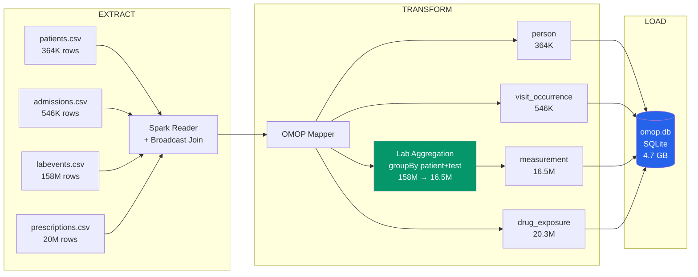

# MIMIC-IV → OMOP Common Data Model Converter

A PySpark-based ETL pipeline that converts MIMIC-IV clinical data (364K patients, 158M lab events) into the OMOP Common Data Model v5.4, outputting a validated SQLite database.

## The Problem

MIMIC-IV stores ICU data in its own proprietary schema — patients, admissions, labevents, prescriptions — each with different column names and formats. OMOP CDM is the standard used by 800+ healthcare institutions worldwide (OHDSI network). Without conversion, MIMIC-IV data cannot be used with OMOP-compatible tools like ATLAS, ACHILLES, or PatientLevelPrediction.

**Challenge at scale:** 364,627 patients generate 158 million lab readings and 20 million prescriptions. Naive approaches (loading everything into pandas, filtering with SQL IN() clauses) crash on commodity hardware (32GB RAM).

## The Solution

A four-stage PySpark pipeline that handles the full dataset on a single machine:



## Engineering Problems and Fixes

| # | Problem | Root Cause | Fix | Result |
|---|---------|-----------|-----|--------|
| 1 | `.isin(364K IDs)` crashes JVM | Spark generates a single SQL IN() with 364,627 elements, overflowing the code generator | **Broadcast join** — replicate 3MB patient ID table to each executor | No OOM, sub-second filter |
| 2 | `toPandas()` kills process | Collecting 37M rows into pandas exceeds 32GB RAM | **`toLocalIterator()`** — stream rows in 500K batches to SQLite | Peak memory ~2GB |
| 3 | `row_number()` shuffles all data to one partition | `Window.orderBy()` without `partitionBy()` forces global sort | **`monotonically_increasing_id()`** — each partition gets its own ID range | No data movement |
| 4 | 158M lab rows too large for downstream analysis | One patient x 30 days x 15 tests = 450 rows each | **groupBy(patient, test)** — aggregate to mean/max/min per patient per test | 158M → 16.5M rows |
| 5 | Crash at step 4 loses 3 hours of work | No checkpointing | **Resume logic** — skip tables that already have data in SQLite | Re-run picks up where it stopped |

## OMOP Schema Mapping

### Source (MIMIC-IV) → Target (OMOP CDM v5.4)
``` patients.csv → person
subject_id → person_id (direct)
gender (M/F) → gender_concept_id (M=8507, F=8532)
anchor_age → year_of_birth

admissions.csv → visit_occurrence
hadm_id → visit_occurrence_id (direct)
subject_id → person_id (FK)
admittime / dischtime → visit_start/end_datetime
(all admissions) → visit_concept_id = 9201 (Inpatient)

labevents.csv → measurement (AGGREGATED)
subject_id + itemid → groupBy keys
avg(valuenum) → value_as_number
max(valuenum) → value_max
min(valuenum) → value_min
count(*) → num_observations
itemid → measurement_concept_id (LOINC mapped)

prescriptions.csv → drug_exposure
subject_id → person_id (FK)
drug → drug_source_value (text preserved)
starttime / stoptime → drug_exposure_start/end_date
drug_concept_id → 0 (RxNorm mapping not yet implemented)
```

### LOINC Vocabulary Mapping

| MIMIC itemid | Lab Test | OMOP Concept ID | Standard |
|---|---|---|---|
| 50862 | Sodium | 3024561 | LOINC |
| 50861 | Potassium | 3024560 | LOINC |
| 50912 | Creatinine | 3018677 | LOINC |
| 50893 | Calcium | 3008480 | LOINC |
| 50889 | Troponin T | 3022192 | LOINC |
| 50809 | Glucose | 3007637 | LOINC |
| 50868 | Alkaline Phosphatase | 3027314 | LOINC |
| 50883 | Bilirubin | 3023181 | LOINC |

## Validation Results
```person: 364,627
visit_occurrence: 546,028
measurement: 16,588,459
drug_exposure: 20,292,611
─────────────────────────────
total rows: 37,791,725
database size: 4,774 MB

null person_id: 0 ✓
null measurement values: 0 ✓
orphan foreign keys: 0 ✓
gender mapping coverage: 100% ```

## Spark Configuration

| Setting | Value | Why |
|---|---|---|
| `spark.driver.memory` | 16g | Broadcast 364K patient IDs |
| `spark.executor.memory` | 8g | Per-executor allocation |
| `spark.sql.shuffle.partitions` | 200 | Parallelism on single machine |
| `spark.sql.autoBroadcastJoinThreshold` | 50m | Force broadcast of patient ID table |
| `spark.driver.maxResultSize` | 4g | Handle large partition results in toLocalIterator |

## Quick Start

```bash
# Setup
conda create -n mimic-spark python=3.10
conda activate mimic-spark
pip install pyspark pandas

# Run (requires MIMIC-IV data from PhysioNet)
python convert.py /path/to/mimic-iv/data 364627 data/output

# Validate
python -c "
import sqlite3
conn = sqlite3.connect('data/output/omop.db')
c = conn.cursor()
for t in ['person','visit_occurrence','measurement','drug_exposure']:
    c.execute(f'SELECT COUNT(*) FROM {t}')
    print(f'{t}: {c.fetchone()[0]:,}')
conn.close()
"
```

## Project Structure
``` text
mimic-omop-converter/
├── convert.py # CLI entry point with Spark config and resume logic
├── src/
│ ├── mimic_reader.py # Spark CSV loader with broadcast join
│ ├── omop_mapper.py # MIMIC → OMOP transformations + lab aggregation
│ ├── vocabulary.py # LOINC/RxNorm/SNOMED concept ID mappings
│ └── loader.py # Chunked SQLite writer (toLocalIterator + 500K batches)
├── config/
│ └── omop_schema.sql # OMOP CDM v5.4 DDL
└── data/
└── output/ # Generated omop.db (gitign
```

## Future Work

- Full RxNorm drug mapping via NLM API
- ICD-10 → SNOMED condition_occurrence table
- Procedure mapping (procedures_icd → procedure_occurrence)
- Data quality report (ACHILLES-style profiling)
- PostgreSQL output option

## References

- [OHDSI OMOP CDM v5.4](https://ohdsi.github.io/CommonDataModel/)
- [MIMIC-IV Documentation](https://mimic.mit.edu/)
- [The Book of OHDSI](https://ohdsi.github.io/TheBookOfOhdsi/)
- [EHDEN Academy](https://academy.ehden.eu/)

## Author

**Sohel Ahmed, Ph.D.** — sohelcu06@gmail.com

## FHIR Observation Support

The converter also reads FHIR Observation resources (NDJSON format) and maps them to OMOP measurement. This demonstrates the full EHR → FHIR → OMOP workflow:

1. **Query a FHIR server** (e.g., Epic, Cerner, or public test server like hapi.fhir.org)
2. **Extract Observations** (lab tests, vitals, measurements)
3. **Map LOINC codes** to OMOP concept IDs using Athena vocabulary
4. **Load into OMOP** measurement table

### FHIR Example

```python
from src.fhir_reader import load_fhir_observations

loinc_to_concept = {
    "2345-7": 3004501,  # Glucose
    "777-3": 3013110,   # Platelets
}

measurements = load_fhir_observations('observations.ndjson', loinc_to_concept)
```

Tested with 290 real observations from HAPI FHIR public test server (hapi.fhir.org).
